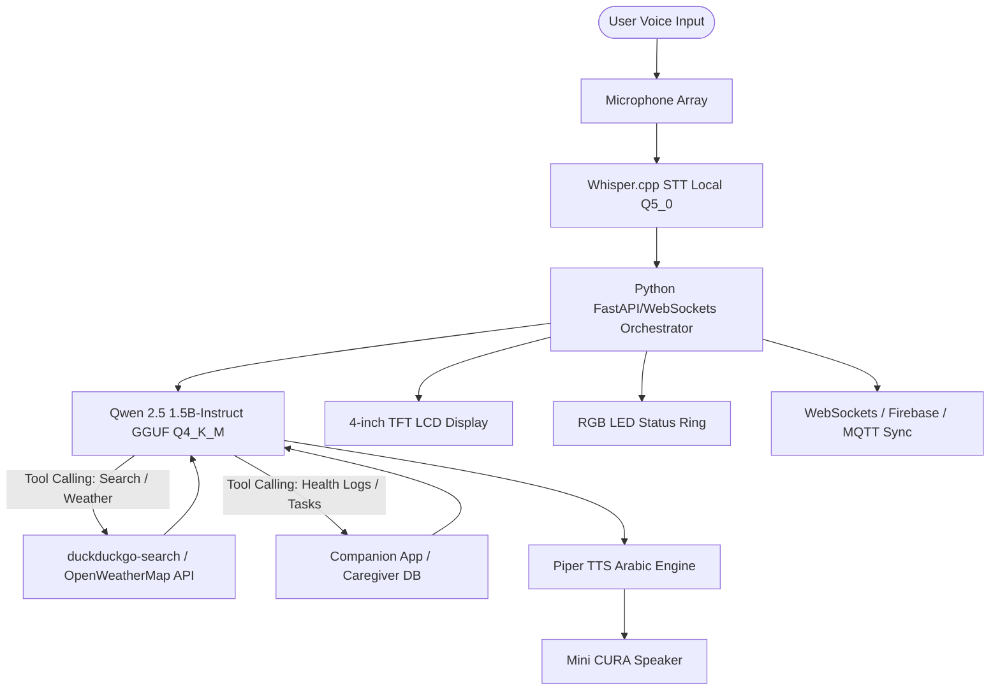
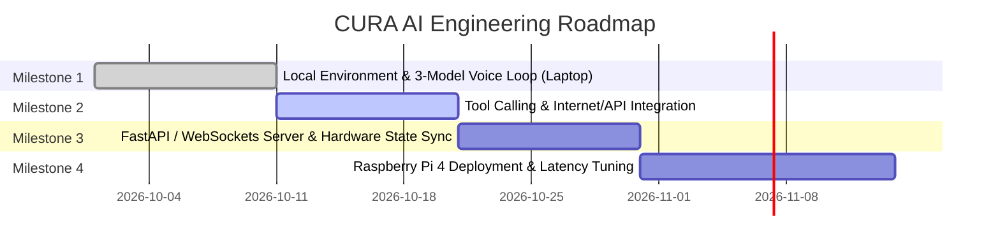

# CURA — Adaptive AI Assistant

<div align="center">


**Adaptive AI Assistant for Care, Focus, and Everyday Living**

[](LICENSE)
[-c51a4a.svg?logo=raspberry-pi&logoColor=white)](https://www.raspberrypi.com/)
[-6851ff.svg)](https://huggingface.co/Qwen)
[](https://github.com/ggerganov/whisper.cpp)
[-green.svg)](https://github.com/rhasspy/piper)
[](#system-architecture)

</div>

---

> **Official Project Name**: **CURA** and nothing else.  
> CURA is a voice-first, multi-modal adaptive AI assistant engineered to dynamically adjust its personality, interface, and cognitive support systems to the user's immediate physical and neurological needs.

---

## 📋 Table of Contents

- [Overview & Vision](#-overview--vision)
- [System Architecture](#-system-architecture)
- [Adaptive Modes](#-adaptive-modes)
  - [1. Normal CURA (Phase 1)](#1-normal-cura-general-assistant)
  - [2. Alzheimer's Mode (Phase 2A)](#2-alzheimers-mode-support--memory-care)
  - [3. ADHD Mode (Phase 2B)](#3-adhd-mode-focus--impulse-management)
- [Edge AI Pipeline (Raspberry Pi 4 - 4GB RAM)](#-edge-ai-pipeline-raspberry-pi-4---4gb-ram)
- [Mini CURA Hardware Architecture](#-mini-cura-hardware-architecture)
- [AI Team Requirements & Roadmap](#-ai-team-requirements--roadmap)
- [Official Brand & Design System](#-official-brand--design-system)
- [Repository Structure](#-repository-structure)
- [Getting Started](#-getting-started)
- [Important Disclaimer](#-important-disclaimer)
- [License](#-license)

---

## 🌟 Overview & Vision

Standard voice assistants offer a rigid, one-size-fits-all experience that frequently fails users dealing with cognitive overload, memory degradation, or neurodivergent challenges. 

**CURA** solves this through a modular, adaptive intelligence model:
1. **Core Voice & OS Automation**: A proactive assistant capable of controlling applications, answering web queries, setting timers, and interpreting user intent.
2. **Context-Adaptive Specialization**: Switches dynamically into specialized cognitive operating environments tailored for **Alzheimer's care** and **ADHD task management**.
3. **Optimized Edge Intelligence**: Powered by an on-device local AI pipeline deployed on a **Raspberry Pi 4 Model B (4GB RAM)**, keeping interactions private, low-latency, and resilient.



---

## 🧠 Adaptive Modes

### 1. Normal CURA (General Assistant)
The baseline everyday voice assistant designed for seamless digital interaction:
- **Natural Voice Interaction**: Real-time conversational dialogue in both Arabic and English (`FR-NJ-001`).
- **OS & Application Management**: Voice-driven launching, terminating, and switching of applications (`FR-NJ-002`, `FR-NJ-003`).
- **Timers & Scheduling**: Hands-free countdowns, timers, and alarm tracking (`FR-NJ-004`).
- **Live Web Intelligence**: Real-time information lookups and weather updates via local tool-calling integrations (`FR-NJ-005`).
- **Screen Awareness**: Visual context understanding and screen description assistance (`FR-NJ-006`).

---

### 2. Alzheimer's Mode (Support & Memory Care)
Designed specifically to ease cognitive burden, provide emotional reassurance, and maintain user safety:
- **Question History & Pattern Tracking (`FR-ALZ-001`)**: Logs questions with timestamps. When a question is repeated, CURA responds with equal warmth, patience, and clarity every single time without expressing frustration, while quietly logging repetition metrics for caregiver and physician review.
- **Item Location Memory (`FR-ALZ-003`)**: Remembers where personal belongings (keys, glasses, wallet) were placed and recalls them upon voice query.
- **Medication & Meal Reminders with Voice Confirmation (`FR-ALZ-006`, `FR-ALZ-007`)**: Delivers scheduled audio and visual reminders. Actively listens for patient confirmation (*"أخدته خلاص"*), parses intent via the LLM, and updates caregiver adherence logs.
- **2-Day Activity Report for Caregivers (`FR-ALZ-009`)**: Caregivers can ask *"عمل إيه آخر يومين؟"* to receive a concise, natural Arabic spoken summary of medication adherence, question frequency, and daily milestones.
- **Emergency Button & Voice Trigger (`FR-ALZ-011`, `FR-HW-004`)**: Instant physical push button and emergency keyword trigger that immediately transmits the user's live location and status to emergency contacts.
- **Calming Emotional Support & Pep Talk (`FR-ALZ-008`)**: Guided slow breathing exercises and soothing voice prompts during episodes of distress or disorientation.
- **Memory Book (`FR-ALZ-012`)**: Curated narration of family moments, photographs, and cherished memories.
- **Simplified High-Contrast UI (`FR-ALZ-013`)**: Large tactile buttons, high-contrast typography, minimal screens, and a persistent date, day, and time display (`FR-ALZ-005`).

---

### 3. ADHD Mode (Focus & Impulse Management)
Tailored to mitigate distractions, executive dysfunction, and impulsive task-switching:
- **Smart Task Prioritization (`FR-ADHD-002`)**: Analyzes user tasks and automatically arranges them based on urgency, deadline, and cognitive load.
- **One Task at a Time UI (`FR-ADHD-004`)**: Displays only the single active task, hiding upcoming backlogs to eliminate cognitive overwhelm.
- **Pause & Confirmation Safeguards (`FR-ADHD-001`)**: Intercepts impulsive application switches or distractions with a gentle prompt, allowing the user a moment to reflect before switching context.
- **Smart Time Estimation & Alerts (`FR-ADHD-003`)**: Estimates realistic task duration and offers gentle nudges when a session exceeds estimated time limits.
- **Focus Mode Sessions (`FR-ADHD-005`)**: Silences non-critical notifications, restricts distracting applications, and tracks progress through a visual progress bar (`FR-ADHD-009`).
- **Stress Break & Guided Breathing (`FR-ADHD-007`)**: Automatically breaks down large tasks into smaller sub-steps and initiates 2-minute reset breathing exercises when signs of stress are detected.
- **User Dashboard (`FR-ADHD-011`)**: Visual tracking of completed focus sprints, streak milestones, and task metrics.

---

## ⚡ Edge AI Pipeline (Raspberry Pi 4 - 4GB RAM)

To ensure privacy, offline resilience, and fast turnaround, all AI models run locally on the **Raspberry Pi 4 Model B (4GB RAM)** within a strictly controlled **2.2 GB – 2.8 GB RAM budget**:

| Layer | Component | Specification | Memory Footprint | Runtime & Rationale |
| :--- | :--- | :--- | :---: | :--- |
| **LLM** | **Qwen 2.5 (1.5B-Instruct)** | GGUF `Q4_K_M` | **~1.0 GB** | Runs on `llama.cpp` / `Ollama`. Exceptional native Arabic fluency, fast inference on Pi CPU (**8–10 tokens/sec**), and robust **Tool Calling** support for APIs and web search. *(Dev/Laptop alternative: Qwen 2.5 3B or Gemma 2 2B).* |
| **STT** | **Whisper.cpp** | `base` or `small` (`Q5_0`) | **~150 – 250 MB** | Lightweight, on-device speech-to-text. High-accuracy transcription of Egyptian and Modern Standard Arabic without cloud latency. |
| **TTS** | **Piper TTS** | Egyptian / Standard Arabic ONNX | **~65 MB** | Ultra-fast local neural speech synthesis. Response latency **< 0.2s** with minimal CPU overhead. |
| **OS / Runtime** | Raspberry Pi OS + Python Orchestrator | FastAPI + WebSockets | **~1.0 – 1.4 GB** | Coordinates audio pipeline, controls hardware peripherals, and maintains cloud synchronization. |
| **Total Memory** | **Complete System Footprint** | — | **~2.2 – 2.8 GB** | Safely operates within the 4GB RAM threshold with zero OOM risk. |

---

## 🛠️ Mini CURA Hardware Architecture

The **Mini CURA** physical device is a compact desktop companion designed to run CURA's intelligence natively without bulky hardware overhead:

> **Hardware Decision Note**: To maximize CPU cycles and RAM for voice interaction, local language processing, and real-time connectivity, the camera module has been excluded from the hardware build. Mini CURA connects via high-speed Wi-Fi to sync with companion apps and cloud databases.

```
       +-------------------------------------------------------+
       |                  Mini CURA Enclosure                  |
       |                                                       |
       |  [ RGB LED Ring ] ---- Status Indication (Listening/  |
       |                               Processing/Speaking/Err)|
       |                                                       |
       |  [ 4" LCD Display ] -- Timers, Tasks, Reminders, Date |
       |                                                       |
       |  [ Mic Array ] ------- Far-field Audio Input          |
       |  [ Speaker ] --------- Piper TTS Voice Output         |
       |  [ Push Button ] ----- Physical Emergency Trigger     |
       |                                                       |
       |  +-------------------------------------------------+  |
       |  |          Raspberry Pi 4 Model B (4GB)           |  |
       |  |  - Active Cooling Fan                           |  |
       |  |  - SanDisk Extreme A2 MicroSD (32GB / 64GB)     |  |
       |  |  - Wi-Fi 802.11ac (Internet & App Sync)         |  |
       |  +-------------------------------------------------+  |
       +-------------------------------------------------------+
```

### Hardware Components:
1. **Core Processing Unit**: Raspberry Pi 4 Model B (4GB RAM) with active cooling fan.
2. **Storage**: High-speed SanDisk Extreme A2 MicroSD (32GB or 64GB) for rapid model loading.
3. **Microphone**: USB / I2S Far-Field Microphone Array.
4. **Speaker**: 3W / 5W Speaker Module for crystal-clear voice output.
5. **Status LED Ring (FR-HW-006)**:
   - 🔵 **Blue**: Listening (`Listening`)
   - 🟢 **Green**: Reasoning / Processing (`Processing`)
   - 🟡 **Yellow**: Speaking (`Speaking`)
   - 🔴 **Red**: Alert / Emergency Mode (`Alert/Emergency`)
6. **Display (FR-HW-007)**: 4-inch TFT LCD displaying real-time task status, medication cards, persistent clock, and timer countdowns.
7. **Emergency Push Button (FR-HW-004)**: Physical button triggering instantaneous emergency alerts and GPS location broadcast.
8. **Connectivity (FR-HW-008)**: Wi-Fi connection for synchronization with companion apps and caregiver dashboards.

---

## 🎯 AI Team Requirements & Roadmap

Based on the official AI engineering specifications (`DOC-20261014-WA0050.pdf`), deliverables are structured across 4 actionable milestones:



### Detailed Milestones:
1. **Milestone 1 — Local Multi-Model Pipeline (Laptop Prototyping)**:
   - Set up `Ollama` / `llama.cpp` with `Qwen 2.5 (1.5B-Instruct) GGUF Q4_K_M`.
   - Integrate `Whisper.cpp` (`base`/`small` `Q5_0`) and `Piper TTS` (Arabic).
   - Deliver a unified Python script capturing microphone audio, transcribing speech, generating LLM responses in Arabic, and outputting voice via speaker.
2. **Milestone 2 — Tool Calling & External APIs**:
   - Program Python tool functions for `duckduckgo-search` and `OpenWeatherMap`.
   - Build patient log summarization functions (last 2 days history summarizer in Egyptian Arabic).
   - Build intent verification functions for medication confirmation (*"أخدته خلاص"*) and task completion.
3. **Milestone 3 — AI Local Service & Hardware Bridge**:
   - Wrap the AI pipeline in a robust `FastAPI` / `WebSockets` service.
   - Synchronize LLM states with the RGB LED Ring indicator and the 4-inch screen GUI.
   - Implement real-time event listener for push notifications (medication reminders, task schedules).
4. **Milestone 4 — Raspberry Pi 4 Deployment & Performance Optimization**:
   - Flash and configure Raspberry Pi 4 OS on SanDisk Extreme A2 MicroSD.
   - Benchmark end-to-end voice latency and verify system memory consumption remains between 2.2 GB and 2.8 GB.
   - Stress-test Wi-Fi stability (`FR-HW-008`) and continuous thermal performance under active cooling.

---

## 🎨 Official Brand & Design System

CURA's visual identity reflects clinical trust, modern focus, and calming empathy:

| Role | Color Name | Preview | HEX | RGB | Recommended UI & Brand Usage |
| :--- | :--- | :---: | :---: | :---: | :--- |
| **Primary Brand** | Azure Electric Blue | `■` | `#16B9FE` | `22, 185, 254` | Primary actions, branding, core engine |
| **Voice & Vitality** | Electric Cyan | `■` | `#60EFEB` | `96, 239, 235` | Waveforms, voice listening ring glow |
| **Cognitive Focus** | Orchid Violet | `■` | `#AF6AFB` | `175, 106, 251` | ADHD Mode, timers, focus sprints |
| **Empathy & Care** | Turquoise Mint | `■` | `#3FEDBA` | `63, 237, 186` | Alzheimer's Mode, health confirmations |
| **Primary Typography** | Pure Studio White | `■` | `#FFFFFF` | `255, 255, 255` | Main titles, wordmark, clear text |
| **Secondary Typography**| Glacier Slate | `■` | `#E8EDF1` | `232, 237, 241` | Subtitles, descriptions, metadata |
| **Canvas Background** | Midnight Obsidian | `■` | `#131B26` | `19, 27, 38` | Main dark background canvas |
| **Surface Card** | Deep Navy Slate | `■` | `#1A2433` | `26, 36, 51` | Cards, elevated dialogs, panels |

### Signature Gradients:
```css
/* CURA Signature Flow */
background: linear-gradient(135deg, #16B9FE 0%, #AF6AFB 50%, #3FEDBA 100%);

/* Cognitive Focus (ADHD Mode) */
background: linear-gradient(135deg, #16B9FE 0%, #AF6AFB 100%);

/* Calming Care (Alzheimer's Mode) */
background: linear-gradient(135deg, #16B9FE 0%, #3FEDBA 100%);
```

---

## 📁 Repository Structure

```
CURA/
├── .gitignore                                 # Git ignore patterns for AI models, builds & OS files
├── LICENSE                                    # MIT License
├── README.md                                  # Complete project documentation & technical specs
├── CURA project details.pdf                   # Master project overview & modes documentation
├── SRS AID (1).pdf                            # Software Requirements Specification (IEEE 830-1998)
├── DOC-20261014-WA0050.pdf                    # AI Team technical requirements & roadmap
├── مش هنعمل كاميرة و هنشغل الهاردوير بالنت...pdf # Hardware decision & on-device AI pipeline specs
├── Cura_Brand_Color_Palette.pdf               # Visual identity & brand design guide (PDF)
├── Cura_Brand_Color_Palette.docx              # Visual identity & brand design guide (DOCX)
├── cura_official_color_palette.md             # Design tokens & color system specifications
├── Cura Logo.svg                              # Official vector master logo
├── Cura Icon.svg                              # Official vector app/hardware icon
├── Cura Favicon.svg                           # Official web favicon
├── Cura Word.svg                              # Official wordmark vector
├── Cura Word_without_ai_adaptive.svg          # Simplified wordmark vector
└── cura_harmony_logo_1791226392255.jpg        # Master brand visual asset
```

---

## 🚀 Getting Started

### Prerequisites
- Python 3.10+
- `git`
- `ffmpeg` & `portaudio19-dev` (for audio capture and playback)
- `Ollama` or `llama.cpp`
- Raspberry Pi 4 Model B (4GB RAM) with 64-bit Raspberry Pi OS (for hardware deployment)

### Laptop Development Quickstart
```bash
# Clone repository
git clone https://github.com/killerfrost2004u/Cura.git
cd Cura

# Create Python virtual environment
python -m venv venv
source venv/bin/activate  # On Windows: venv\Scripts\activate

# Install dependencies
pip install fastapi uvicorn websockets duckduckgo-search requests sounddevice numpy

# Pull Qwen 2.5 1.5B via Ollama
ollama run qwen2.5:1.5b-instruct
```

---

## ⚠️ Important Disclaimer

CURA is an assistive technology prototype designed for research and educational purposes.
- **Not Medical Advice**: CURA does not diagnose, treat, prevent, or cure Alzheimer's disease, ADHD, or any medical condition.
- **Not a Replacement for Professional Care**: The system does not replace certified healthcare professionals, caregivers, or emergency response services.
- **No Safety Guarantee**: While CURA provides monitoring, reminders, and alerts, it cannot guarantee an accident-free or hazard-free environment.

---

## 📄 License

This project is licensed under the [MIT License](LICENSE).
