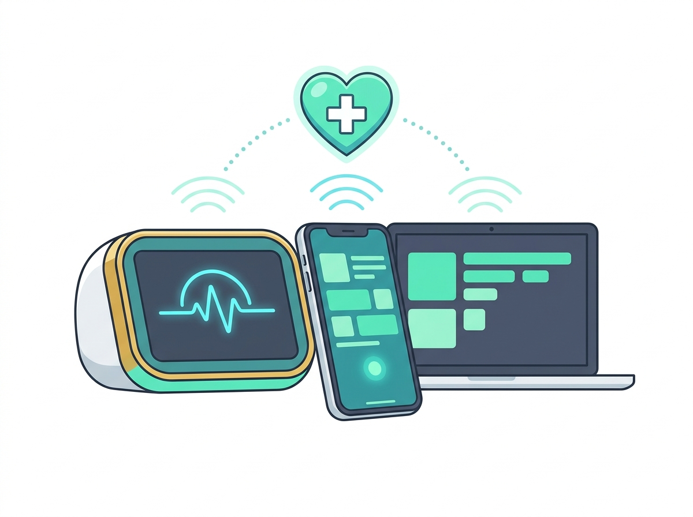
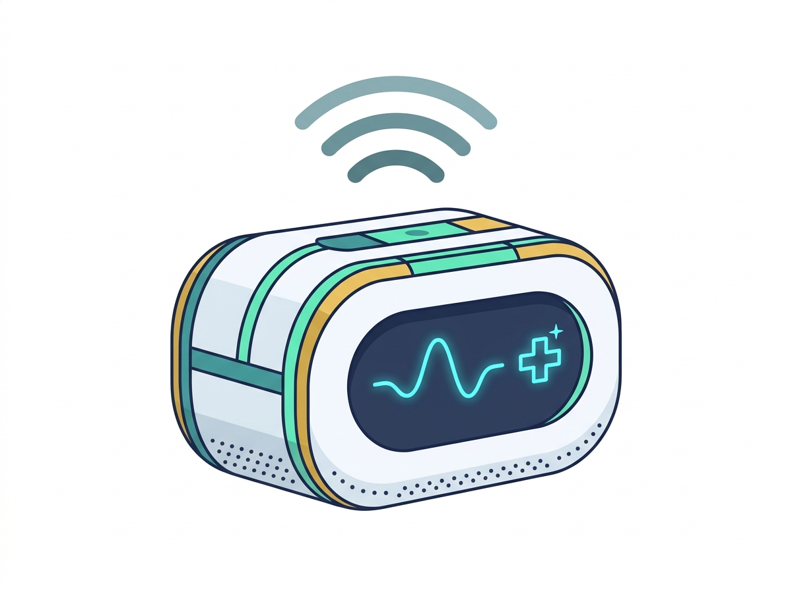
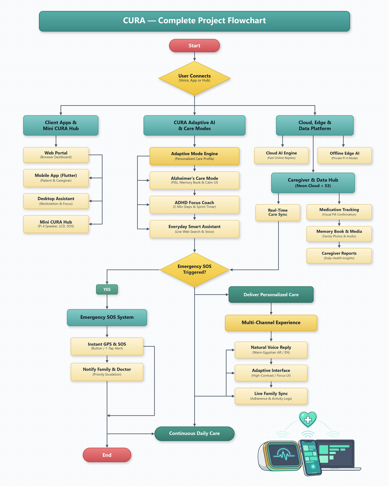
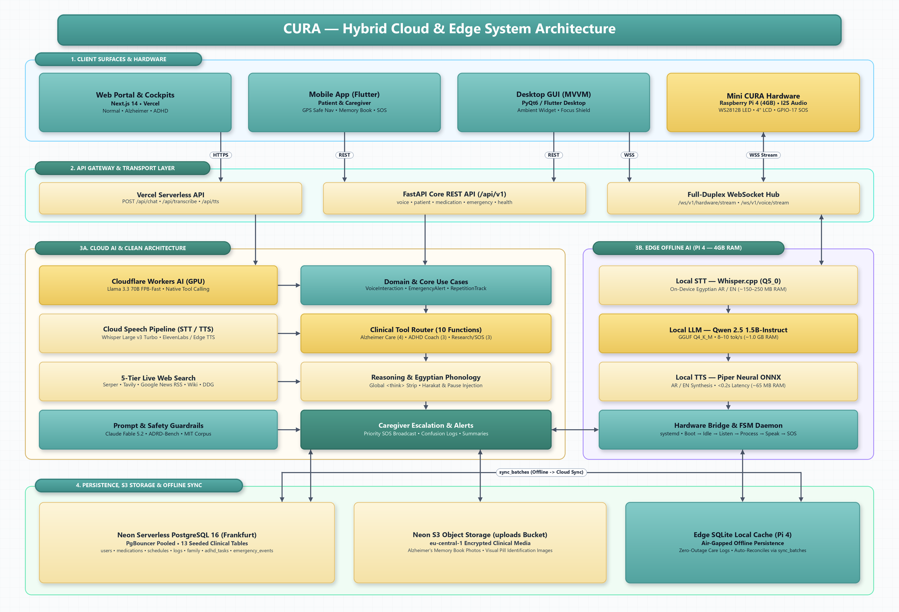
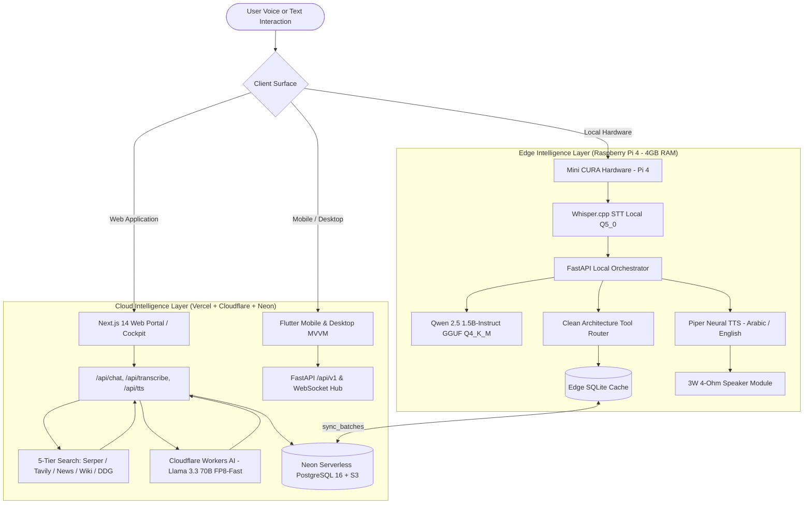
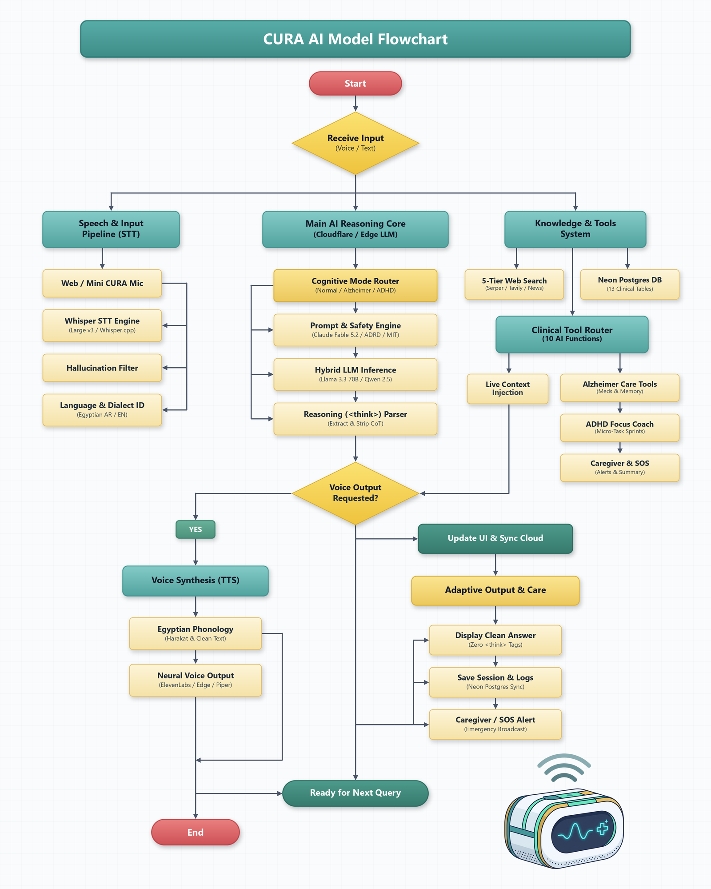
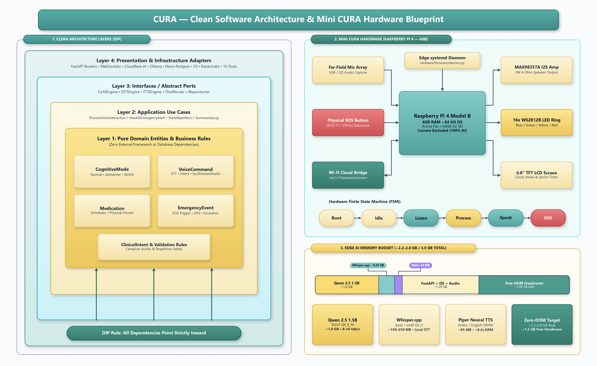

# CURA — Adaptive Healthcare & Intelligence AI Assistant

<div align="center">


**Adaptive Multi-Modal AI Assistant for Healthcare Caregiving, Cognitive Focus, and Everyday Intelligence**

[](https://cura-drab.vercel.app/)
[](LICENSE)
[-c51a4a.svg?logo=raspberry-pi&logoColor=white)](https://www.raspberrypi.com/)
[](https://neon.tech)
[-F38020.svg?logo=cloudflare&logoColor=white)](https://developers.cloudflare.com/workers-ai/)
[](#-claude-fable-52--51-system-prompt-architecture)
[](docs/CURA_Architecture_Diagrams.md)
[-brightgreen.svg)](#-deterministic-verification--automated-tests)

</div>

---

> **Official Project Name**: **CURA** and nothing else.  
> CURA is a voice-first, multi-modal adaptive AI assistant engineered to dynamically adjust its personality, reasoning depth, interface contrast, and cognitive support systems to the user's immediate physical, neurological, and clinical needs.

---

## 📋 Table of Contents

- [Overview & Vision](#-overview--vision)
- [Complete Project Flowchart (Client & Stakeholder View)](#-complete-project-flowchart-client--stakeholder-view)
- [Hybrid Architecture (Edge AI + Cloudflare GPU + Neon DB)](#-hybrid-architecture)
- [CURA AI Model Pipeline](#-cura-ai-model-pipeline)
- [Three Adaptive Cognitive Modes](#-three-adaptive-cognitive-modes)
  - [1. Normal Mode (Everyday Research & Clinical Reasoning)](#1-normal-mode-everyday-research--clinical-reasoning)
  - [2. Alzheimer's Mode (Validation Therapy & Memory Sanctuary)](#2-alzheimers-mode-validation-therapy--memory-sanctuary)
  - [3. ADHD Mode (Executive Dysfunction & Anti-Paralysis Coach)](#3-adhd-mode-executive-dysfunction--anti-paralysis-coach)
- [Claude Fable 5.2 / 5.1 System Prompt Architecture](#-claude-fable-52--51-system-prompt-architecture)
- [Production Neon PostgreSQL Database (13 Seeded Tables)](#-production-neon-postgresql-database)
- [Ten Function-Calling Clinical & Search Tools](#-ten-function-calling-clinical--search-tools)
- [Live Web Search Engine (5-Tier Multi-Engine Pipeline)](#-live-web-search-engine)
- [Mini CURA Hardware & Clean Software Architecture](#-mini-cura-hardware--clean-software-architecture)
- [Edge AI Pipeline (Raspberry Pi 4 - 4GB RAM)](#-edge-ai-pipeline-raspberry-pi-4---4gb-ram)
- [Deterministic Verification & Automated Tests](#-deterministic-verification--automated-tests)
- [Official Brand & Design System](#-official-brand--design-system)
- [Repository Structure](#-repository-structure)
- [Getting Started](#-getting-started)
- [Important Disclaimer](#-important-disclaimer)
- [License](#-license)

---

## 🌟 Overview & Vision

Standard voice assistants offer a rigid, one-size-fits-all experience that frequently fails users dealing with cognitive overload, memory degradation, or neurodivergent challenges.

**CURA** solves this through a modular, adaptive intelligence framework:
1. **Context-Adaptive Specialization**: Switches dynamically between **Everyday Research & Clinical Reasoning**, **Alzheimer's Care**, and **ADHD Anti-Paralysis Focus**.
2. **Hybrid Cloud + Edge Inference**:
   - **Cloud Intelligence**: High-throughput **Cloudflare Workers AI (`@cf/meta/llama-3.3-70b-instruct-fp8-fast`)** with sub-2s serverless GPU latency, live web search, and native tool calling.
   - **Edge Hardware**: On-device privacy-first pipeline on **Raspberry Pi 4 Model B (4GB RAM)** running quantized GGUF models with zero external dependency.
3. **Clinical Dataset Alignment**: Deeply fitted with validated behavioral and clinical datasets:
   - **ADRD-Bench & Validation Therapy** for Alzheimer's care.
   - **MIT Task-Breakdown & Scaffolding Corpus** for ADHD executive function.
   - **Claude Fable 5.2 & 5.1 Persona & Safety Standards** for everyday research.

<div align="center">

<table>
  <tr>
    <td align="center" width="50%">
      <br />
      <sub><strong>CURA Connected Care Ecosystem</strong><br />Web Portal, Flutter Mobile, Desktop MVVM &amp; Mini CURA Hub</sub>
    </td>
    <td align="center" width="50%">
      <br />
      <sub><strong>Mini CURA Embedded AI Hub</strong><br />Dedicated Bedside Companion on Raspberry Pi 4 (4GB)</sub>
    </td>
  </tr>
</table>

</div>

---

## 📊 Complete Project Flowchart (Client & Stakeholder View)

Designed for clients, caregivers, clinicians, and product reviewers, this end-to-end flowchart illustrates how users connect across web, mobile, desktop, or physical Mini CURA hardware into adaptive AI care modes, cloud/edge synchronization, and real-time Emergency SOS escalation:

<div align="center">
  <a href="docs/CURA_Whole_Project_Client_Flowchart.png">
    
  </a>
</div>

- **Multi-Surface Entry:** Unified experience across `Web Portal`, `Mobile App (Flutter)`, `Desktop Assistant`, and the `Mini CURA Hub` physical speaker & LCD unit.
- **Care-Aware Adaptation:** Automatically routes interactions into `Alzheimer's Care Mode` (visual pill confirmation, memory book), `ADHD Focus Coach` (2-minute micro-steps & sprint timer), or `Everyday Smart Assistant`.
- **Proactive Safety Branching:** Continuously evaluates emergency distress (`GPIO-17` hardware button, 1-tap mobile/UI trigger, or voice distress) to dispatch GPS telemetry and notify Priority 1 & 2 family/physician contacts.

---

## 🏗️ Hybrid Architecture

CURA spans four coordinated architectural layers — connecting **Client Surfaces & Physical Hardware**, **API & WebSocket Transport**, **Dual Cloud / Edge AI Runtimes**, and **Neon PostgreSQL 16 + S3 + Edge SQLite**:

<div align="center">
  <a href="docs/CURA_System_Architecture_Diagram.png">
    
  </a>
</div>

> Editable Mermaid blueprints for all subsystems (System Topology, Clean Architecture Dependency Inversion, End-to-End STS Sequence, Hardware FSM, and SOS/Offline Sync) are maintained in [`docs/CURA_Architecture_Diagrams.md`](docs/CURA_Architecture_Diagrams.md).

<details>
<summary>View Editable Mermaid System Diagram</summary>



</details>

---

## 🧠 CURA AI Model Pipeline

The end-to-end cognitive processing pipeline from voice capture (`STT`) and mode routing through hybrid reasoning, internal `<think>` sanitization, 5-tier live knowledge injection, 10 clinical tools, and natural Egyptian Arabic / English neural voice synthesis (`TTS / STS`):

<div align="center">
  <a href="docs/CURA_AI_Model_Flowchart.png">
    
  </a>
</div>

---

## 🎯 Three Adaptive Cognitive Modes

### 1. Normal Mode (Everyday Research & Clinical Reasoning)
- **Claude Fable 5.2 & 5.1 Alignment**: Governed by Bottom-Line-Up-Front (BLUF) formatting for knowledge work and warm, concise prose for casual interaction.
- **Live Web Search**: Automatically queries real-time Serper Google Search, Tavily, Google News RSS, and Wikipedia for breaking news, stock prices, clinical papers, and market data without claiming to be offline.
- **Authentic Dialect Mirroring**: Speaks fluent, respectable Egyptian Arabic (*"العامية المصرية الحقيقية"*) when addressed in Arabic, and 100% pure articulate English when addressed in English (strictly preventing Arabic honorific leakage into English replies).
- **Strict Intent Grounding**: Simple greetings receive warm welcomes and assistance check-ins; absolute prohibition against unsolicited math lessons or geometry formulas.
- **Live Cockpit**: Available at [`/testing/normal`](https://cura-drab.vercel.app/testing/normal).

---

### 2. Alzheimer's Mode (Validation Therapy & Memory Sanctuary)
- **Validation Therapy & ADRD-Bench Standard**: Validates the patient's emotional reality rather than confronting memory lapses.
- **Repetition Invariance (`FR-ALZ-001`)**: Responds with identical patience, warmth, and reassurance regardless of how many times a question is repeated.
- **Sensory & Visual Medication Confirmation (`FR-ALZ-006`)**: Identifies medications by visual and physical descriptors (*"القرص الأصفر الصغير"، "العلبة البيضا اللي عليها خط أحمر"*).
- **Personalized Routine Scoping**: Specifically shares personal routine logs (such as morning Concor 5mg with daughter Sarah) only when the patient inquires about their daily routine or doses.
- **High-Contrast 15.2:1 WCAG AAA UI**: Large tactile touch targets, persistent clock, and emergency SOS broadcast.
- **Live Cockpit**: Available at [`/testing/alzheimer`](https://cura-drab.vercel.app/testing/alzheimer).

---

### 3. ADHD Mode (Executive Dysfunction & Anti-Paralysis Coach)
- **MIT Task-Breakdown & Scaffolding Corpus**: Eliminates executive dysfunction (*"Wall of Awful"*) by isolating exactly **ONE single 2-to-5-minute micro-action**.
- **Anti-Robotic Egyptian Dialect**: Energetic, youth-friendly coaching (*"يلا بينا يا بطل"، "عاش"، "بص يا فنان"*) with strict prohibition against stiff robotic Modern Standard Arabic (*"مرحباً! أهلاً بك! أنا سعيد بمساعدتك"*).
- **Dopamine Micro-Rewards**: Immediate audio-visual celebration upon micro-task completion to reinforce momentum.
- **Time Blindness Calibration**: Replaces vague time suggestions with tangible 15-minute Pomodoro sprints.
- **Live Cockpit**: Available at [`/testing/adhd`](https://cura-drab.vercel.app/testing/adhd).

---

## 📜 Claude Fable 5.2 / 5.1 System Prompt Architecture

CURA's prompt engine is synchronized across the Python backend ([prompt_templates.py](backend/src/infrastructure/llm/prompt_templates.py)) and Next.js frontend ([route.ts](web-frontend/src/app/api/chat/route.ts)) to enforce Anthropic's Claude Fable specifications:

| Dimension | Specification & Enforcement |
| :--- | :--- |
| **Working Persona** | **Bottom-Line-Up-Front (BLUF)**: Deliverable or key finding is stated first; zero conversational fluff or apologies. |
| **Chatting Persona** | Natural conversational prose with minimal markdown; warm empathy and respectful curiosity. |
| **Child Safety Redline** | Extreme caution regarding minors; strictly refuses sexual, romantic, or grooming content. If CURA finds itself reframing a request, that reframing is the trigger to refuse. |
| **CBRN & Harm Boundaries** | Zero actionable guidance, blueprints, or optimization for chemical, biological, radiological, nuclear weapons, or malware. |
| **Medical Guidance** | Prioritizes verified clinical product labels (DailyMed, PubMed); avoids declarative clinical diagnosis or unverified causal interpretations. |
| **Refusal Demeanor** | Refusals are calm, conversational, polite, and neutral—never preachy, moralizing, or patronizing. |

---

## 🗄️ Production Neon PostgreSQL Database

The application connects to **Neon Serverless PostgreSQL 16 (eu-central-1 AWS)** with full connection pooling and automatic UUID resolution. All **13 tables** are fully structured, indexed, and seeded:

| # | Table Name | Seeded Records | Purpose in CURA |
|---|------------|:--------------:|-----------------|
| 1 | `users` | 4 records | Patients (`Hajj Ibrahim`, `Karim`), Caregiver (`Dr. Ahmed`), Neurologist (`Dr. Tarek`). |
| 2 | `caregiver_patient_relations` | 2 records | Permission scopes (`manage_medications`, `view_gps`, `edit_memory_book`). |
| 3 | `devices` | 2 records | Hardware pairings (Mini CURA Pi 4 and ESP32) with telemetry flags. |
| 4 | `family_members` | 4 records | Visual memory book profiles, relations, and biographical memories. |
| 5 | `medications` | 3 records | Concor 5mg, Aricept 10mg, Concerta 18mg with physical appearance tags. |
| 6 | `medication_schedules` | 3 records | Morning and evening schedules with recurring weekday alarms. |
| 7 | `medication_logs` | 3 records | Audited adherence records marked as `TAKEN` with caregiver timestamps. |
| 8 | `cognitive_confusion_logs`| 4 records | Question repetition frequency metrics (e.g. repeated time checks). |
| 9 | `adhd_tasks` | 3 records | Micro-step breakdowns, priority rankings, and completion flags. |
| 10| `focus_sessions` | 2 records | 25-minute Pomodoro sprints and pause interruption counters. |
| 11| `emergency_contacts` | 4 records | Priority 1 and Priority 2 family/clinical escalation hierarchy. |
| 12| `emergency_events` | 1 record | Critical SOS events with GPS coordinates (30.0444, 31.2357). |
| 13| `sync_batches` | 1 record | Offline-to-cloud bidirectional batch synchronization audits. |

---

## 🛠️ Ten Function-Calling Clinical & Search Tools

Registered in [backend/src/infrastructure/tools/](backend/src/infrastructure/tools/) through a Clean Architecture `IToolRouter`:

```
               ┌────────────────── Tool Router ──────────────────┐
               │                                                 │
     [ Alzheimer Care ]                 [ ADHD Focus ]         [ Research & Safety ]
  • lookup_medications             • decompose_adhd_task     • search_web
  • confirm_medication_dose        • get_adhd_tasks          • get_current_weather
  • lookup_family_memory           • complete_adhd_task      • get_caregiver_patient_summary
  • lookup_item_location
```

1. **`search_web`**: 5-tier live search pipeline (`Tavily` → `Serper Google Search` → `Google News RSS` → `Wikipedia API` → `DuckDuckGo`) for real-time market data, stocks, news, and research.
2. **`get_current_weather`**: Meteorological data for any city.
3. **`lookup_medications`**: Fetches daily medication schedules and visual pill descriptions.
4. **`confirm_medication_dose`**: Marks patient doses as taken in `medication_logs`.
5. **`lookup_family_memory`**: Memory book recall for family members and reassuring memories.
6. **`lookup_item_location`**: Locates misplaced personal belongings (keys, glasses, prayer beads).
7. **`decompose_adhd_task`**: Breaks overwhelming projects into a single 2-to-5-minute micro-step.
8. **`get_adhd_tasks`**: Retrieves active Pomodoro sprints and task queue.
9. **`complete_adhd_task`**: Logs task completion and dispenses dopamine audio-visual reward.
10. **`get_caregiver_patient_summary`**: Generates multi-day clinical activity summaries for doctors and families.

---

## 🌐 Live Web Search Engine

The web search subsystem in [web_search_tool.py](backend/src/infrastructure/tools/web_search_tool.py) and [route.ts](web-frontend/src/app/api/chat/route.ts) uses a **5-Tier Resilient Search Pipeline** engineered to prevent datacenter IP blocks on Vercel / AWS:
- **Tier 1 — Tavily AI Search**: High-signal AI search synthesis via `https://api.tavily.com/search` (`TAVILY_API_KEY`).
- **Tier 2 — Serper Google Search**: Real-time localized Google Search results (`gl=eg`/`us`, `hl=ar`/`en`) via `https://google.serper.dev/search` (`SERPER_API_KEY`).
- **Tier 3 — Google News RSS Feed**: Zero-auth, unblockable real-time headlines, financial updates, and regional news from `https://news.google.com/rss/search`.
- **Tier 4 — Wikipedia API**: Instant structured knowledge from `ar.wikipedia.org` and `en.wikipedia.org`.
- **Tier 5 — DuckDuckGo Engine**: `ddgs` / HTML snippet extraction & Instant Answer API fallback, paired with strict prompt grounding that prevents false offline refusals.

---

## 🤖 Mini CURA Hardware & Clean Software Architecture

CURA enforces **Dependency Inversion (DIP)** in the backend (`core/entities` → `use_cases` → `core/interfaces` → `infrastructure` / `presentation`) paired with dedicated embedded engineering for the **Mini CURA (Raspberry Pi 4 — 4GB)** bedside device:

<div align="center">
  <a href="docs/CURA_Clean_Hardware_Architecture.png">
    
  </a>
</div>

- **Hardware Peripherals (`hardware/README.md`)**: Far-field USB/I2S Mic Array, `MAX98357A` I2S 3W 4Ω Speaker Amp, `16x WS2812B` RGB LED Ring (Blue/Green/Yellow/Red), `4.0"` TFT LCD Screen, and industrial **GPIO-17 Physical SOS Push Button** (`250ms` interrupt debounce). Camera hardware is excluded so 100% of CPU and RAM serve speech and local LLM tasks.
- **Deterministic Finite State Machine**: `Boot` → `Idle` → `Listen` → `Process` → `Speak` → `SOS` orchestrated by `hardware/firmware/daemon.py`.

---

## ⚡ Edge AI Pipeline (Raspberry Pi 4 - 4GB RAM)

For fully air-gapped or offline deployment, CURA operates on a **Raspberry Pi 4 Model B (4GB RAM)** within a **~2.2 – 2.8 GB RAM budget**:

| Layer | Component | Specification | Memory Footprint | Runtime Rationale |
| :--- | :--- | :--- | :---: | :--- |
| **LLM** | **Qwen 2.5 (1.5B-Instruct)** | GGUF `Q4_K_M` | **~1.0 GB** | Native Arabic fluency, fast CPU inference (**8–10 tokens/sec**), and tool calling support via `llama.cpp` / `Ollama`. |
| **STT** | **Whisper.cpp** | `base` / `small` (`Q5_0`) | **~150 – 250 MB** | On-device, low-latency speech transcription for Egyptian Arabic and English. |
| **TTS** | **Piper TTS** | Arabic / English ONNX | **~65 MB** | Neural speech synthesis with **< 0.2s** latency on ARM Cortex-A72. |
| **Runtime**| FastAPI + WebSockets | Python 3.12 Clean Architecture | **~1.0 – 1.4 GB** | Orchestrates audio loop, hardware peripherals, and Neon cloud synchronization. |
| **Total** | **System Footprint** | — | **~2.2 – 2.8 GB** | Zero out-of-memory (OOM) risk on a 4GB Pi board. |

---

## 🧪 Deterministic Verification & Automated Tests

### 1. Pytest Backend Suite (24/24 Passing)
Run against live Neon PostgreSQL and Cloudflare Workers AI client:
```powershell
cd backend
$env:PYTHONPATH="D:\Cura\backend"
python -m pytest tests -v
```
```
tests/test_api.py::test_root_endpoint PASSED                             [  4%]
tests/test_api.py::test_health_endpoint PASSED                           [  8%]
tests/test_api.py::test_emergency_trigger_endpoint PASSED                [ 12%]
tests/test_api.py::test_patient_summary_endpoint PASSED                  [ 16%]
tests/test_api.py::test_voice_interact_text PASSED                       [ 20%]
tests/test_clinical_tools.py::test_all_clinical_tools_registered PASSED  [ 25%]
tests/test_clinical_tools.py::test_lookup_medications_neon PASSED        [ 29%]
tests/test_clinical_tools.py::test_confirm_medication_dose_neon PASSED   [ 33%]
tests/test_clinical_tools.py::test_lookup_family_memory_neon PASSED      [ 37%]
tests/test_clinical_tools.py::test_lookup_item_location_neon PASSED      [ 41%]
tests/test_clinical_tools.py::test_decompose_adhd_task_neon PASSED       [ 45%]
tests/test_clinical_tools.py::test_get_adhd_tasks_neon PASSED            [ 50%]
tests/test_clinical_tools.py::test_complete_adhd_task_neon PASSED        [ 54%]
tests/test_clinical_tools.py::test_clinical_prompts_standards PASSED     [ 58%]
tests/test_cloudflare_ai.py::test_cloudflare_llm_reasoning_extraction PASSED [ 62%]
tests/test_cloudflare_ai.py::test_cloudflare_llm_mock_fallback_on_error PASSED [ 66%]
tests/test_cloudflare_ai.py::test_cloudflare_whisper_transcription PASSED [ 70%]
tests/test_cloudflare_ai.py::test_cloudflare_whisper_empty_audio_guard PASSED [ 75%]
tests/test_cloudflare_ai.py::test_container_dependency_injection PASSED  [ 79%]
tests/test_prompts.py::test_cognitive_modes_configured PASSED            [ 83%]
tests/test_prompts.py::test_system_prompts_arabic PASSED                 [ 87%]
tests/test_tool_router.py::test_tool_router_registration PASSED          [ 91%]
tests/test_tool_router.py::test_weather_tool_execution PASSED            [ 95%]
tests/test_tool_router.py::test_caregiver_summary_tool PASSED            [100%]
======================= 24 passed in 45.26s =======================
```

### 2. Next.js Production Build
```powershell
npm --prefix web-frontend run build
```
- **11/11 routes statically generated / server-rendered without TypeScript or ESLint errors**.
- Instant chatbox input clearing on query submit verified across all cockpits.
- Universal `<think>...</think>` regex extraction eliminating exposed reasoning tags.

---

## 🎨 Official Brand & Design System

| Role | Color Name | Preview | HEX | UI Usage |
| :--- | :--- | :---: | :---: | :--- |
| **Primary Brand** | Azure Electric Blue | `■` | `#16B9FE` | Core branding, primary actions, logo accent |
| **Voice & Vitality** | Electric Cyan | `■` | `#60EFEB` | Live waveforms, microphone active rings |
| **Cognitive Focus** | Orchid Violet | `■` | `#AF6AFB` | ADHD mode, Pomodoro timers, sprint indicators |
| **Empathy & Care** | Turquoise Mint | `■` | `#3FEDBA` | Alzheimer's mode, medical logs, safety checks |
| **Primary Typography** | Pure Studio White | `■` | `#FFFFFF` | Headings, high-contrast text |
| **Secondary Typography**| Glacier Slate | `■` | `#E8EDF1` | Metadata, timestamps, supporting copy |
| **Canvas Background** | Midnight Obsidian | `■` | `#0C141F` | Deep dark UI canvas |
| **Surface Card** | Deep Navy Slate | `■` | `#1A2433` | Glassmorphic floating cards and dialogs |

---

## 📁 Repository Structure

```
CURA/
├── backend/                                   # Clean Architecture Python Backend
│   ├── src/
│   │   ├── core/                              # Pure Entities & Abstract Interfaces
│   │   ├── use_cases/                         # Clinical Workflows & Interaction Engines
│   │   ├── infrastructure/                    # Neon DB, Cloudflare AI, & Clinical Tools
│   │   └── presentation/api/                  # FastAPI Routers & Health Endpoints
│   ├── scripts/                               # Neon Database Clinical Data Seeder
│   └── tests/                                 # 24 Automated Unit & Integration Tests
├── web-frontend/                              # Next.js 14+ Showcase & Cockpit Portal
│   ├── src/app/
│   │   ├── api/chat/route.ts                  # Cloudflare AI + 5-Tier Search Gateway
│   │   ├── api/transcribe/route.ts            # Whisper Large v3 Turbo STT Endpoint
│   │   ├── api/tts/route.ts                   # ElevenLabs & Edge Neural TTS Endpoint
│   │   ├── testing/alzheimer/page.tsx         # Voice & Reassurance Sanctuary
│   │   ├── testing/adhd/page.tsx              # Anti-Paralysis Executive Coach
│   │   └── testing/normal/page.tsx            # Claude Fable Research Cockpit
│   └── public/                                # Vector Assets & Brand Logos
├── mobile-app/                                # Flutter Clean Architecture App Scaffold
├── desktop-gui/                               # MVVM Desktop Companion Specification
├── hardware/                                  # Mini CURA Pi 4 Specifications & Firmware
├── database/                                  # PostgreSQL 16 Schemas & ERD Diagrams
├── docs/                                      # High-Resolution Flowcharts & Architecture Docs
│   ├── assets/
│   │   ├── cura_ai_hub_icon.png               # Mini CURA AI Hub Flat-Vector Illustration
│   │   └── cura_ecosystem_icon.png            # Connected Care Ecosystem Vector Illustration
│   ├── CURA_Whole_Project_Client_Flowchart.png
│   ├── CURA_AI_Model_Flowchart.png
│   ├── CURA_System_Architecture_Diagram.png
│   ├── CURA_Clean_Hardware_Architecture.png
│   ├── CURA_Architecture_Diagrams.md          # Complete Mermaid Blueprints & Index
│   ├── generate_cura_ai_flowchart.py          # AI Flowchart Supersampled Renderer
│   └── generate_cura_project_diagrams.py      # Project & Architecture Diagram Generator
├── README.md                                  # Complete Technical Blueprint & Docs
└── LICENSE                                    # MIT License
```

---

## 🚀 Getting Started

### 1. Web Portal Setup (Next.js)
```bash
cd web-frontend
npm install
npm run dev
# Open http://localhost:3000 in your browser
```

### 2. Backend Setup (FastAPI & Clean Architecture)
```bash
cd backend
python -m venv venv
source venv/bin/activate  # On Windows: venv\Scripts\activate
pip install -r requirements.txt
python -m pytest tests -v
```

### 3. Database Seeding (Neon PostgreSQL)
```bash
cd backend
$env:DATABASE_URL="your-neon-postgres-connection-string"
python scripts/seed_clinical_data.py
```

### 4. Regenerating Visual Diagrams
```bash
pip install pillow numpy
python docs/generate_cura_ai_flowchart.py
python docs/generate_cura_project_diagrams.py
```

---

## ⚠️ Important Disclaimer

CURA is an assistive technology system engineered for research, productivity, and caregiver assistance.
- **Not Clinical Diagnosis**: CURA does not diagnose, treat, or cure Alzheimer's disease, ADHD, or medical conditions.
- **Support System**: CURA assists and supports licensed healthcare providers and family caregivers; it does not replace professional medical judgment or emergency response teams.

---

## 📄 License

This project is licensed under the [MIT License](LICENSE).
