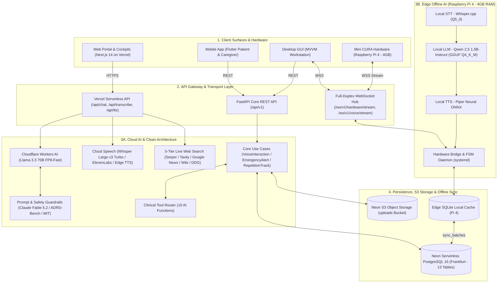
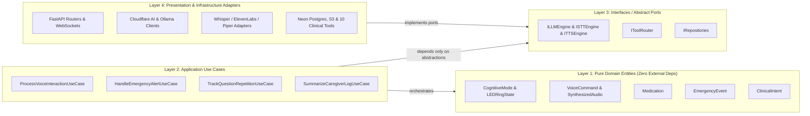
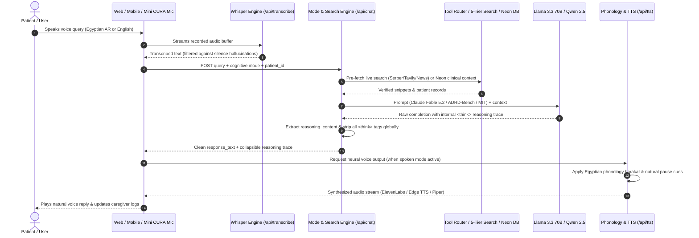
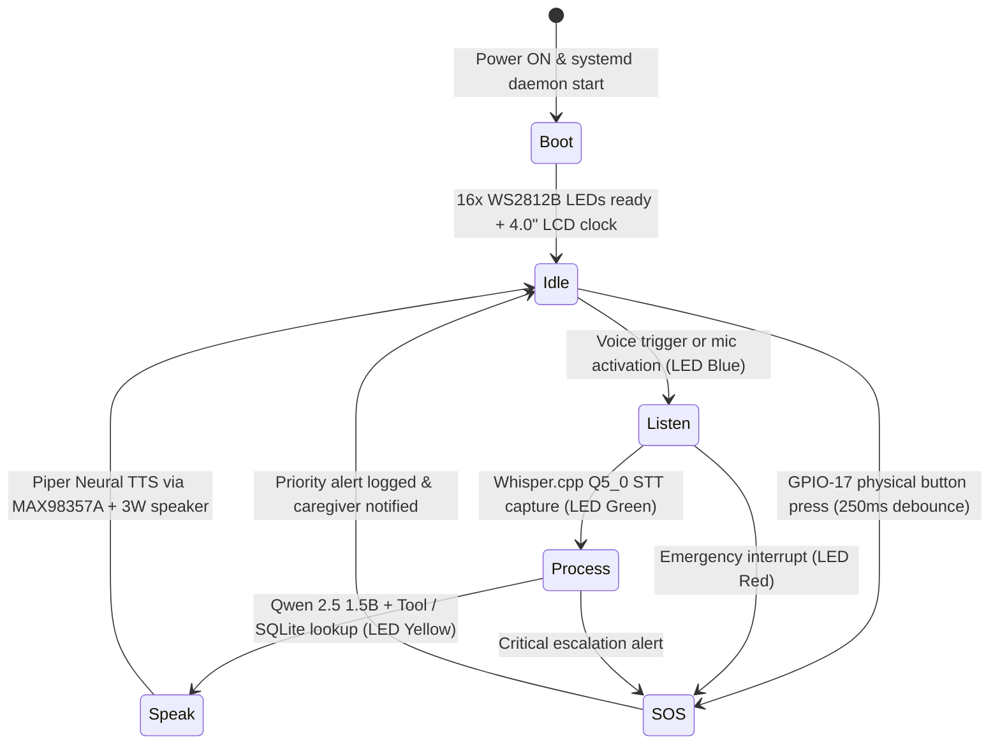
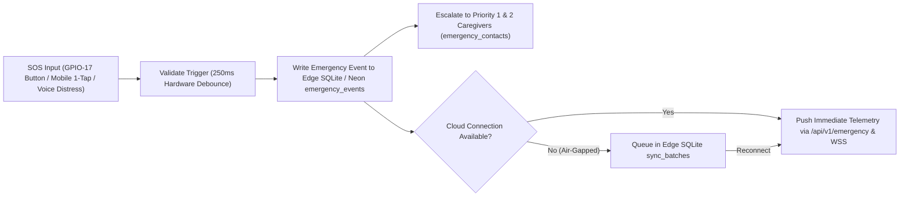

# CURA — Complete Visual Flowcharts & Architecture Blueprint

> Comprehensive visual documentation covering the **CURA AI Cognitive Engine**, the **Whole-Project Client Ecosystem**, and the **Hybrid Cloud + Edge Hardware Architecture**.

---

## High-Resolution Visual Diagrams (PNG)

| Diagram | Target Audience | Key Scope | File |
| :--- | :--- | :--- | :--- |
| **Whole-Project Client Flowchart** | Clients, Stakeholders & Clinical Reviewers | Multi-channel client apps (`Web`, `Flutter`, `Desktop`, `Mini CURA Hub`), Adaptive Care Modes, Cloud/Edge Sync, and Emergency SOS flow | [CURA_Whole_Project_Client_Flowchart.png](CURA_Whole_Project_Client_Flowchart.png) |
| **CURA AI Model Flowchart** | AI / ML Engineers & Technical Leads | End-to-end STT → Cognitive Mode Router → Claude Fable 5.2 / ADRD / MIT Prompt Engine → Hybrid LLM → `<think>` Parser → 5-Tier Search & 10 Tools → Egyptian TTS | [CURA_AI_Model_Flowchart.png](CURA_AI_Model_Flowchart.png) |
| **Hybrid Cloud & Edge System Architecture** | System Architects & DevOps | 4-tier architecture spanning Client Surfaces, Vercel Serverless & FastAPI `/api/v1` + WebSockets, Cloudflare Workers AI + Raspberry Pi 4 Offline Stack, and Neon Postgres 16 + S3 + Edge SQLite | [CURA_System_Architecture_Diagram.png](CURA_System_Architecture_Diagram.png) |
| **Clean Software & Mini CURA Hardware** | Backend & Embedded Firmware Teams | Concentric Clean Architecture Dependency Inversion layers (`Core → Use Cases → Interfaces → Infrastructure`) alongside Pi 4 peripherals, FSM, and 4GB RAM budget | [CURA_Clean_Hardware_Architecture.png](CURA_Clean_Hardware_Architecture.png) |

---

## 1. Hybrid Cloud & Edge System Architecture (Mermaid)

---

## 2. Clean Software Architecture & Dependency Inversion (Mermaid)

All source code under `backend/src/` enforces strict Dependency Inversion: inner domain rules and entities have zero external framework or database imports, while outer infrastructure adapters implement abstract ports defined in `src/core/interfaces/`.

---

## 3. End-to-End Speech-to-Speech (STS) Interaction Sequence (Mermaid)

---

## 4. Mini CURA Hardware Finite State Machine & Edge Memory Allocation

Target device: **Raspberry Pi 4 Model B (4GB RAM)** running 64-bit Raspberry Pi OS (`systemd` daemon in `hardware/firmware/daemon.py`). Camera module is excluded so 100% of CPU and RAM support low-latency local AI.

---

## 5. Emergency SOS & Offline-to-Cloud Synchronization Flow

---

*Regenerate any diagram cleanly from Python via [`docs/generate_cura_ai_flowchart.py`](generate_cura_ai_flowchart.py) and [`docs/generate_cura_project_diagrams.py`](generate_cura_project_diagrams.py).*
